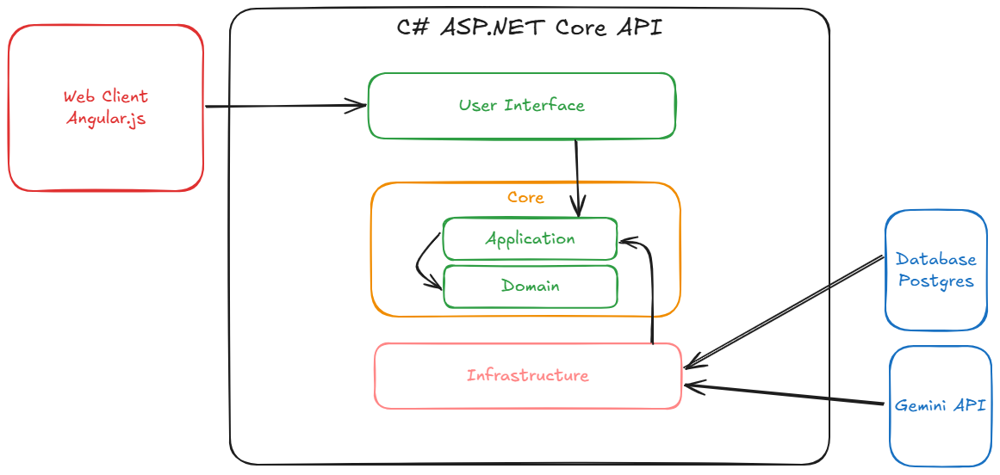

# EI Dungeon API

Backend module for the [EI Dungeon monorepo](../README.md). Read [ARCHITECTURE.md](ARCHITECTURE.md) for application boundaries and [AGENTS.md](AGENTS.md) for contributor rules.

Run the commands in this document from `api/`, unless another directory is specified. Open `api/` as the editor workspace when using its existing `.vscode` launch/tasks configuration.

## Architecture



See [ARCHITECTURE.md](./ARCHITECTURE.md) for the current application and container architecture.

## Run with Docker Compose

This is the simplest local setup. It runs the backend and PostgreSQL together and requires:

- Docker Engine
- Docker Compose v2 (`docker compose`)

From the `api/` module directory, create your local environment file only if it does not already exist:

```powershell
Copy-Item .env.example .env
```

Edit `.env` before starting the stack. The file is ignored by Git and must not be committed.

| Variable | Purpose | Example default |
|---|---|---|
| `POSTGRES_DB` | PostgreSQL database created for the application | `ei_db` |
| `POSTGRES_USER` | PostgreSQL application user | `ei_dungeon` |
| `POSTGRES_PASSWORD` | Local PostgreSQL password | Development placeholder; change it |
| `POSTGRES_PORT` | PostgreSQL port published on the host | `5432` |
| `BACKEND_PORT` | Backend listen port inside the container and on the host | `8080` |
| `ASPNETCORE_ENVIRONMENT` | ASP.NET Core environment | `Development` |
| `CORS_ALLOWED_ORIGINS` | Comma-separated origins allowed by CORS | `http://localhost:8000` |
| `OPENROUTER_API_KEY` | API key used for generated game responses | Replace the placeholder |
| `JWT_SECRET` | Signing secret for access tokens | Replace the development placeholder |

Compose reads `.env`, builds the PostgreSQL connection string, and maps values to ASP.NET Core environment keys such as `TokenConfigurations__Secret`. These container environment variables override the base values in `appsettings.json`. The `.env` variables are not passed blindly to every container.

Build and start the complete stack:

```powershell
docker compose up -d --build
```

The explicit Compose project name is `ei-dungeon-back`, preserving named database volume `ei-dungeon-back_postgres_data` after relocation. PostgreSQL must pass its health check before the backend starts. On a fresh database volume, PostgreSQL also creates the `uuid-ossp` extension. The backend then applies all pending EF Core migrations during startup.

Check the containers and logs:

```powershell
docker compose ps
docker compose logs -f
```

With the default environment values, open:

- API health: <http://localhost:8080/health>
- Swagger UI in the `Development` environment: <http://localhost:8080/swagger>

If port `8080` or `5432` is already occupied, change `BACKEND_PORT` or `POSTGRES_PORT` in `.env` and start the stack again.

Stop both services without removing their containers or database data:

```powershell
docker compose stop
```

Remove both service containers and their network while preserving database data:

```powershell
docker compose down
```

To reset the local database completely, remove the named volume too:

```powershell
docker compose down -v
```

The `-v` command permanently deletes the local Compose database. PostgreSQL initialization scripts run only when a new data volume is created. If the initialization SQL changes, reset the volume or apply the SQL manually to the existing database.

## Manage only the backend with Docker Compose

Use the service name `backend` to work on the API without stopping or recreating PostgreSQL.

Build only the backend image:

```powershell
docker compose build backend
```

Rebuild and recreate only the backend while PostgreSQL is already running:

```powershell
docker compose up -d --build --no-deps backend
```

The `--no-deps` option prevents Compose from starting or recreating dependencies. Without it, `docker compose up -d backend` may also start the declared `postgres` dependency. Use the complete stack command first when PostgreSQL is not running.

Operate only the backend container:

```powershell
# Stop only the backend
docker compose stop backend

# Start only the existing backend container
docker compose start backend

# Restart only the backend
docker compose restart backend

# Follow only backend logs
docker compose logs -f backend
```

These commands preserve the PostgreSQL container and its named volume. Do not use `docker compose down` when the intention is to affect only the backend because `down` targets the entire Compose project.

## Run without Docker

Install:

- .NET 9 SDK
- PostgreSQL
- `dotnet-ef` if migrations need to be managed locally

Create a PostgreSQL database named `ei_db` and enable the required extension:

```sql
CREATE EXTENSION IF NOT EXISTS "uuid-ossp";
```

Keep real configuration in .NET User Secrets or environment variables. The main values are:

- `PostgresConnection:PostgresConnectionString`
- `keys:OpenRouterApiKey`
- `TokenConfigurations:Secret`
- `Cors:AllowedOrigins`

Run migrations from the application project directory:

```powershell
Set-Location .\ei-back
dotnet ef database update --context EIContext
Set-Location ..
```

Start the API:

```powershell
dotnet run --project .\ei-back\ei-back.csproj
```

The default seeded login is `admin` / `admin123`. Change the password after the first login. Game information can be seeded through `POST /api/game/GameInfo` using `ei-back/Infrastructure/Utils/GameInfoSeeding.json` as an example request body.

## Tests

```powershell
dotnet build .\ei-back\ei-back.csproj
dotnet test .\ei-back.Tests\ei-back.Tests.csproj
```

Database-backed tests are enabled by `VERIFICATION_TEST_CONNECTION`. Point it only at an isolated PostgreSQL database with the application migrations and `uuid-ossp` applied; without it, those tests are skipped. Ordinary tests do not require an AI key or email delivery.

## Container image pipeline

The [GitHub Actions workflow](../.github/workflows/api-container.yml) builds the application, runs unit tests, and builds the Linux AMD64 Docker image on pull requests targeting `main` and pushes to `main`. Commands run from `api/`, which is also the Docker build context. A failed build or test prevents the container job from running. The copied workflow under `api/.github/` is an inactive reference; the root workflow is authoritative.

Only pushes to `main` publish to GitHub Container Registry:

- `ghcr.io/wilknisoliveira/ei-dungeon/api:latest`
- `ghcr.io/wilknisoliveira/ei-dungeon/api:sha-<full-commit-sha>`

Use the commit tag to select a specific build. The workflow derives the image path from the repository name and uses the built-in `GITHUB_TOKEN` with package write permission. GitHub Actions and package publishing must be allowed by repository or organization policies. Configure pull access in GitHub package settings, then point `BACKEND_IMAGE` at a published tag or digest when deploying.

Pull requests never log in to the registry or publish images. Database credentials, the JWT secret, and AI API keys are only needed when running the application. This workflow does not deploy the application or change the local Docker Compose setup.

To require these checks before merging, configure a branch protection rule or ruleset for `main` requiring `API build and test` and `API container (publish on main)`. The `API container` workflow uses its own concurrency group and Docker cache scope, separate from the web image. No remote ruleset changes or image publication are performed by the local migration.


## Verification and recovery email (Resend)

The backend sends email verification and password recovery codes through the Resend SDK. Configure these backend-only settings with User Secrets or environment variables:

| Setting | Environment variable | Value |
|---|---|---|
| `Resend:ApiToken` | `Resend__ApiToken` | Resend API key with permission to send emails |
| `Resend:From` | `Resend__From` | Sender allowed by your Resend account, e.g. `EI Dungeon <noreply@your-domain.com>` |
| `VerificationCode:HashKey` | `VerificationCode__HashKey` | Independent stable random secret for code protection, at least 32 UTF-8 bytes |

For local Docker Compose, populate `RESEND_API_TOKEN`, `RESEND_FROM` and `VERIFICATION_CODE_HASH_KEY` in the Git-ignored `.env`; Compose maps them to the settings above. Direct `dotnet run` reads User Secrets in Development. The placeholders in appsettings.json do not contain working credentials.

```powershell
dotnet user-secrets set "Resend:ApiToken" "YOUR_RESEND_API_KEY" --project .\ei-back\ei-back.csproj
dotnet user-secrets set "Resend:From" "EI Dungeon <noreply@your-domain.com>" --project .\ei-back\ei-back.csproj
```

The sender/domain must be allowed by Resend; see [Resend's .NET setup](https://resend.com/docs/send-with-dotnet). API acceptance does not guarantee inbox delivery. Messages are localized using the request culture (frontend header Accept-Language: en, pt-BR or es), defaulting to English; the expiration wording comes from the issued code lifetime. Delivery failures do not undo registration or expose account existence through request responses. No automatic resend worker or delivery webhook is included.
